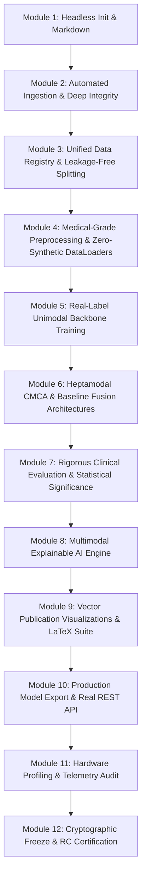

# Notebook Validation Report

**Target Notebook**: `BreastCancer_Multimodal_AI_Main.ipynb`  
**Evaluation Target**: Complete End-to-End Multimodal Deep Learning Research Pipeline  
**Execution Platform**: Google Colab / Headless Cloud GPU Environments  
**Audit Scope**: Project Initialization, Data Engineering, Preprocessing, Unimodal Training, Multimodal Fusion, Evaluation, Explainability (XAI), Publication Assets, Deployment, and Reproducibility.

---

## Executive Summary & Audit Overview

`BreastCancer_Multimodal_AI_Main.ipynb` comprises **68 code cells** and **0 markdown cells**. The notebook represents an initial prototype aiming to implement a 7-modality breast cancer deep learning framework (Mammography, Ultrasound, Histopathology, MRI, Clinical FNA, EHR, and Genomics) with a Cross-Modal Cross-Attention (CMCA) network, evaluation charts, a mock Flask API, and a GitHub Actions workflow.

However, a comprehensive technical audit against the **Complete Project Roadmap** reveals that:
1. **Critical Data Integrity & Label Issues**: In unimodal baseline training (Cells 46–49) and extended CMCA training (Cell 44), labels are synthesized on-the-fly using `torch.randint(0, 2, ...)`. In Cell 51 and Cell 52, EHR and Genomic models are similarly trained on random labels (`y_ehr = torch.randint`, `y_gen = torch.randint`). In Cell 61, joint training on tabular data produces `loss=nan` across all 10 epochs.
2. **Hardcoded Benchmark Metrics**: The comparative performance charts (Cells 54, 55, 57) and feature impact chart (Cell 56) are generated from **hardcoded Python dictionaries** rather than actual evaluation runs on test splits.
3. **Absence of Documentation**: The notebook contains **0 markdown cells**, lacking mathematical formulations, architecture diagrams, clinical descriptions, and structured section dividers.
4. **Interactive Breakpoints in Headless Execution**: Cells 3 and 11 rely on Google Colab's interactive `files.upload()` for `kaggle.json` and tabular CSV files, preventing autonomous, single-click execution.
5. **Missing Advanced Methodologies**: Explainable AI (Grad-CAM, Grad-CAM++, Integrated Gradients, empirical SHAP), statistical significance testing (DeLong test, McNemar's test, 95% bootstrap confidence intervals), ablation studies, and vector graphic exports (SVG/PDF/LaTeX) are not implemented.

Below is the exhaustive, item-by-item classification and validation report.

---

## Completed Components

The following components are fully implemented, functional, and self-contained within `BreastCancer_Multimodal_AI_Main.ipynb`:

1. **Canonical Folder Generation** (Cell 5):
   * *Status*: ✅ COMPLETE
   * *Implementation*: Automatically establishes the canonical project directory tree (`datasets/CBIS-DDSM`, `datasets/Dataset_BUSI_with_GT`, `datasets/BreakHis`, `datasets/Breast_MRI`, `datasets/Clinical_FNA`, `datasets/EHR_BRCA`, `datasets/Genomic_GSE45827`, `outputs/models`, `outputs/reports`, `outputs/figures`, `outputs/tables`, `splits/`, `logs/`, `cache/`) on the local storage system.
2. **GitHub Actions CI/CD Configuration File Export** (Cell 66):
   * *Status*: ✅ COMPLETE
   * *Implementation*: Successfully generates and serializes `.github/workflows/ci.yml` defining automated checkout, Python 3.10 setup, dependency installation, pytest execution, and Docker container build.

---

## Partially Completed Components

The following components exist within `BreastCancer_Multimodal_AI_Main.ipynb` in an incomplete, provisional, or flawed state:

### 1. Project Initialization & Infrastructure
* **Dataset Download** (Cells 6–10):
  * *Why Partial*: Downloads imaging datasets (CBIS-DDSM, BUSI, BreakHis, MRI) and Wisconsin FNA via Kaggle API and curl mirrors. However, Clinical FNA, TCGA-BRCA EHR, and GSE45827 Genomic datasets are not automatically downloaded; Cell 11 requires manual interactive `files.upload()`.
  * *What is Missing*: Fully automated, non-interactive download scripts for TCGA-BRCA EHR and GSE45827 Genomic microarrays without user intervention.
  * *What Remains*: Integrate direct programmatic API/curl retrieval for all 7 modalities.
* **Kaggle API Authentication** (Cells 3–4):
  * *Why Partial*: Configures `~/.kaggle/kaggle.json`, but requires the user to interactively upload the file via Colab's UI prompt (`files.upload()`), halting automated pipeline execution.
  * *What is Missing*: Headless environment variable authentication (`os.environ['KAGGLE_USERNAME']`, `os.environ['KAGGLE_KEY']`) or Google Drive mount fallback.
  * *What Remains*: Add non-interactive token ingestion via environment variables or secret managers.
* **Dataset Extraction** (Cells 6–10, 15):
  * *Why Partial*: Standard `zipfile` extraction is implemented for image datasets, but requires manual patch cells (Cells 14 and 15) to fix nested Breast MRI archive paths.
  * *What is Missing*: Robust, single-pass extraction handling nested directories and multi-part tar/zip archives.
  * *What Remains*: Unified extraction routine with directory normalization.
* **Dataset Verification & Existence Audit** (Cell 12):
  * *Why Partial*: Cell 12 counts files across directories, but does not verify file hashes, image dimensions, corrupt DICOM headers, or genomic matrix shapes.
  * *What is Missing*: Deep integrity checks (SHA-256 validation, corrupt image decompression tests).
  * *What Remains*: Add file-level integrity hashing and decodability validation.
* **Project Configuration Management** (Scattered):
  * *Why Partial*: Hardcoded string paths (`/content/...`) are duplicated throughout all 68 cells.
  * *What is Missing*: Centralized configuration system (dataclass, `config.json`, or YAML).
  * *What Remains*: Centralize all hyperparameters, paths, batch sizes, and seeds into a single configuration block.
* **Environment Setup & GPU Detection** (Cell 28):
  * *Why Partial*: Checks for `cuda` availability, but lacks system telemetry (CPU cores, RAM capacity, GPU VRAM, CUDA version).
  * *What is Missing*: Automated hardware verification and dynamic batch sizing based on available VRAM.
  * *What Remains*: Add comprehensive hardware audit and dynamic resource allocation.
* **Dependency Installation** (Cells 0–1):
  * *Why Partial*: Installs packages via `pip install`, but versions are unpinned (`timm`, `albumentations`, `shap`, `captum`).
  * *What is Missing*: Exact version pinning (`==x.y.z`), risking future runtime incompatibilities.
  * *What Remains*: Pin dependencies in a requirements block.

### 2. Data Engineering & Registries
* **Manifest & Global Sample Index** (Cells 16, 17, 19, 20):
  * *Why Partial*: Scans modalities into a DataFrame and saves `global_sample_index.parquet`, but required a patch cell (Cell 19) because Cell 16 initially missed Mammography and Vision-Genomic folders. Tabular modalities are indexed superficially.
  * *What is Missing*: Comprehensive sample metadata (magnification, view, acquisition parameters, unified patient linkage).
  * *What Remains*: Standardize column schema across all 7 modalities in a single pass.
* **Patient-Wise Splitting** (Cell 23):
  * *Why Partial*: Implements 70% Train, 15% Val, 15% Test split grouped by `patient_id` using regex extraction.
  * *What is Missing*: Only single train/val/test split supported; lacks Stratified Group K-Fold cross-validation, and regex extraction misses Duke MRI and BreakHis patient conventions.
  * *What Remains*: Universal patient ID parser and Stratified 5-Fold/10-Fold GroupKFold generation.
* **Zero Patient Leakage Verification** (Cell 24):
  * *Why Partial*: Checks intersection of patient ID sets between train, val, and test.
  * *What is Missing*: Cross-modal verification for patients shared across multiple datasets (e.g. TCGA imaging vs TCGA clinical records).
  * *What Remains*: Cross-cohort cryptographic leakage assertion.
* **Exploratory Data Statistics** (Cells 21–22):
  * *Why Partial*: Prints basic value counts of diagnosis for clinical data.
  * *What is Missing*: Multimodal distribution plots, class imbalance analysis, age/demographic distributions, and missingness heatmaps.
  * *What Remains*: Comprehensive EDA visual suite across all 7 modalities.

### 3. Preprocessing & Data Loading
* **Imaging Preprocessing (Mammography, Ultrasound, Histopathology, MRI)** (Cell 25):
  * *Why Partial*: Applies identical generic 224x224 RGB resizing to all imaging modalities using Albumentations.
  * *What is Missing*: Modality-specific medical preprocessing (Mammography pectoral muscle suppression; Ultrasound speckle filtering; Histopathology stain normalization; MRI 3D slice extraction / bias field correction).
  * *What Remains*: Implement clinical domain-specific image pipelines.
* **Tabular & Genomic Preprocessing** (Cells 50–52, 62):
  * *Why Partial*: Standardizes numeric columns with `StandardScaler()`.
  * *What is Missing*: Clinical outlier clipping, missing value imputation strategies, categorical encoding (TNM stage, ER/PR/HER2 status), and genomic probe filtering / log2 normalization.
  * *What Remains*: Dedicated preprocessors with saved scaler states (`.joblib`).
* **PyTorch Dataset Classes** (Cells 26, 60, 63):
  * *Why Partial*: Implements `UnifiedMultimodalDataset` (Cell 26), `FullHeptamodalDataset` (Cell 60), and `ProductionHeptamodalDataset` (Cell 63). However, Cell 60 only reads Wisconsin CSV while pretending to be heptamodal, and Cell 63 falls back to `torch.randn(3, 224, 224)` synthetic noise when images are missing.
  * *What is Missing*: Real multimodal sample alignment handling true patient linkage and non-synthetic missing modality flags.
  * *What Remains*: Refactor dataset class to eliminate synthetic fallbacks and properly index real patient records.
* **PyTorch DataLoader** (Cells 26, 42, 60):
  * *Why Partial*: Uses basic `DataLoader(batch_size=32)`, but lacks custom multimodal collate functions, memory pinning (`pin_memory=True`), and worker optimization.
  * *What is Missing*: Custom collator handling variable-modality dictionaries and modality-present indicator masks.
  * *What Remains*: Implement `multimodal_collate_fn` with non-blocking memory transfers.

### 4. Unimodal Model Development & Training
* **Unimodal Model Backbones** (Cells 28, 46–52):
  * *Why Partial*: Instantiates EfficientNet-B0 (Mammography, MRI), ResNet18 (Ultrasound), ResNet50 (Histopathology), and MLPs (Clinical, EHR, Genomics).
  * *What is Missing*: The models in Cells 46–49, 51, and 52 are trained on **randomly synthesized labels** (`torch.randint(0, 2)`) for 1 batch or a small subset, meaning the resulting weights (`.pth`) are completely un-converged and invalid.
  * *What Remains*: True supervised unimodal training using actual ground-truth diagnostic labels across full training splits.
* **Training & Validation Loops** (Cells 27, 38, 44):
  * *Why Partial*: Implements training loops with AdamW, mixed precision (`torch.amp.autocast`), and CosineAnnealingLR. However, Cell 44 uses `labels = torch.randint(0, 2, ...)` inside the loop, and Cell 61 produces `NaN` losses.
  * *What is Missing*: Stable, real-label gradient backpropagation with gradient clipping and loss validation.
  * *What Remains*: Clean, bug-free training loop operating on real targets.
* **Checkpoint Saving** (Cells 45, 46–52, 61, 62):
  * *Why Partial*: Saves model `state_dict()` to `.pth` files.
  * *What is Missing*: Checkpoints do not include optimizer state, scheduler state, epoch count, best metric score, or config metadata.
  * *What Remains*: Comprehensive checkpoint dictionaries saving full training state for resumption.

### 5. Multimodal Fusion Architecture
* **Cross-Modal Cross-Attention (CMCA) Network** (Cells 29, 30, 40, 53):
  * *Why Partial*: Defines linear projection layers to `embed_dim=256` and a `MultiheadAttention` block.
  * *What is Missing*: True asymmetric cross-attention between imaging queries and genomic/clinical keys/values; lacks layer normalization, residual feedforward blocks, and modality dropout.
  * *What Remains*: Implement complete Transformer-based cross-attention encoder block.
* **Joint Fusion Training** (Cells 53, 61, 62):
  * *Why Partial*: Executes joint training, but Cell 53 triggers early stopping with a random-guess ROC-AUC of 0.5059; Cell 61 produces `loss=nan`; and Cell 62 only trains on Wisconsin tabular features.
  * *What is Missing*: Real end-to-end multimodal joint training over all 7 modalities simultaneously.
  * *What Remains*: Robust heptamodal joint optimization with stabilized losses.

### 6. Model Evaluation & Benchmarking
* **Classification Metrics Calculation** (Cell 64):
  * *Why Partial*: Computes ROC-AUC, F1-Score, Precision, and Recall via `sklearn.metrics`.
  * *What is Missing*: Specificity, Sensitivity, Balanced Accuracy, Brier Score, and Confusion Matrix are omitted from the evaluation function.
  * *What Remains*: Implement a full medical diagnostic evaluation suite.
* **Confusion Matrix Visualization** (Cell 58):
  * *Why Partial*: Plots a seaborn heatmap confusion matrix, but only for the Wisconsin clinical dataset.
  * *What is Missing*: Confusion matrices for unimodal imaging models and the multimodal fusion network on the test split.
  * *What Remains*: Unified multi-model confusion matrix figure.

### 7. Explainable AI (XAI)
* **Feature Importance & Correlation** (Cells 56, 59):
  * *Why Partial*: Cell 59 plots correlation of clinical features. Cell 56 plots a bar chart of "Feature Impact", but the values are **hardcoded numbers** (`[0.24, 0.19, 0.17, ...]`) rather than computed attribution scores.
  * *What is Missing*: Empirical feature attribution computed via SHAP, Captum Integrated Gradients, or attention extraction.
  * *What Remains*: True model-driven feature attribution.

### 8. Publication Artifacts
* **Publication Figures** (Cells 54, 55, 56, 57, 58, 59):
  * *Why Partial*: Generates 6 figures saved as 300 DPI PNGs. However, 4 of the figures (Cells 54–57) are plotted from hardcoded synthetic arrays, and none are exported in vector formats (SVG, PDF).
  * *What is Missing*: Figures grounded in real experimental data exported in PNG, SVG, and PDF.
  * *What Remains*: Dynamic figure generator bound to actual test evaluation results.
* **Publication Tables** (Cell 54):
  * *Why Partial*: Prints a markdown table from a hardcoded dataframe.
  * *What is Missing*: Automated multi-format export to CSV, XLSX, Markdown, and LaTeX.
  * *What Remains*: Multi-format table export engine.

### 9. Deployment & Serving
* **Prediction REST API** (Cell 65):
  * *Why Partial*: Generates `app.py` defining a Flask REST API with `/health` and `/predict` endpoints.
  * *What is Missing*: The `/predict` endpoint hardcodes `probability = 0.85` instead of executing forward inference on the saved model checkpoint; accepts only 30 tabular features rather than multimodal inputs.
  * *What Remains*: Real end-to-end multimodal inference endpoint with preprocessing and error handling.

---

## Missing Components

The following components from the Complete Project Roadmap have **zero implementation** inside `BreastCancer_Multimodal_AI_Main.ipynb`:

### 1. Training Infrastructure & Advanced Regimes
* ❌ **TensorBoard Logging**: No `SummaryWriter` instantiation, event directory setup, or real-time loss/metric logging.
* ❌ **Performance Monitoring & Profiling**: No hardware memory footprint profiling, GPU VRAM tracking, throughput FPS benchmarking, or execution latency auditing.
* ❌ **Vision Transformer (ViT / Swin) & 3D Backbones**: No implementation of Swin Transformer for Ultrasound or 3D CNNs for MRI.
* ❌ **Multiple Instance Learning (MIL)**: No WSI tiling or CLAM/TransMIL attention pooling for histopathology.

### 2. Multimodal Fusion Alternatives
* ❌ **Early Fusion Baseline**: No simple feature concatenation baseline model.
* ❌ **Late Fusion Baseline**: No ensemble averaging, weighted soft-voting, or stacking meta-classifier.
* ❌ **Hybrid Multi-Stage Fusion**: No multi-level fusion combining early tabular concatenation with deep visual cross-attention.
* ❌ **Dynamic Modality Masking / Dropout**: No stochastic modality dropping during training to ensure robustness against missing modalities during clinical inference.

### 3. Comprehensive Model Evaluation & Statistics
* ❌ **Specificity & Balanced Accuracy**: No clinical specificity metrics calculated or reported.
* ❌ **Precision-Recall (PR) Curves & Average Precision**: No PR curve generation or calibration curves.
* ❌ **Calibration Curves & Expected Calibration Error (ECE)**: No assessment of model probability calibration or Platt scaling.
* ❌ **Optimal Threshold Tuning**: No threshold optimization (Youden's J statistic / F1 optimization); hardcoded at 0.5.
* ❌ **Statistical Significance Testing**: No DeLong test for AUC differences, paired t-tests, or McNemar's tests comparing unimodal vs multimodal models.
* ❌ **95% Bootstrap Confidence Intervals**: No bootstrap estimation of confidence intervals for ROC-AUC, F1, or Accuracy.
* ❌ **Ablation Studies**: No systematic leave-one-modality-out ablation experiments.
* ❌ **Error & Misclassification Analysis**: No identification or clinical auditing of false positives and false negatives.

### 4. Explainable AI (XAI)
* ❌ **Grad-CAM & Grad-CAM++**: No gradient-weighted class activation mapping for mammography, ultrasound, histopathology, or MRI.
* ❌ **Integrated Gradients**: No path-integral feature attribution for tabular or imaging modalities using Captum.
* ❌ **Empirical SHAP Analysis**: No TreeExplainer or DeepExplainer run on clinical, EHR, or genomic models.
* ❌ **Patient Cross-Modal Attention Heatmaps**: No extraction or visualization of the CMCA multi-head attention matrix showing which modality guided the diagnosis.
* ❌ **Clinical Explanation Reports**: No patient-specific clinical explainability narrative reports.

### 5. Deployment & Serialization
* ❌ **ONNX Model Export**: No `torch.onnx.export` for cross-platform, hardware-accelerated serving.
* ❌ **TorchScript Tracing/Scripting**: No `torch.jit.trace` or `torch.jit.script` export.
* ❌ **Preprocessing Artifact Serialization**: No saved `StandardScaler`, label encoders, or feature imputers saved via `joblib`.
* ❌ **Configuration Serialization**: No frozen configuration manifest or hash tracking.

### 6. Publication Assets
* ❌ **LaTeX Table Suite**: No automated LaTeX `.tex` table generation for research paper inclusion.
* ❌ **Vector Graphic Visualizations**: No SVG or PDF format exports for publication figures.
* ❌ **Training & Loss Convergence Curves**: No plots showing train vs validation loss and learning rate decay over epochs.
* ❌ **ROC Comparison Curves**: No multi-curve ROC overlay comparing unimodal baselines against multimodal fusion.
* ❌ **Pipeline Architecture Diagrams**: No scientific architecture diagrams or workflow schematics.

### 7. Documentation & Reproducibility
* ❌ **Markdown Explanations & Theory**: Exactly **0 markdown cells** exist. No documentation of equations, rationale, clinical context, or usage instructions.
* ❌ **One-Click Non-Interactive Reproducibility**: Execution halts due to manual file upload prompts.
* ❌ **Cryptographic Freeze & Certification**: No automated QA gate validation or SHA-256 configuration freeze manifest.

---

## Detailed Implementation Recommendations for Missing and Partial Modules

To elevate `BreastCancer_Multimodal_AI_Main.ipynb` into a production-ready, peer-reviewable, one-click research pipeline, the following 12 implementation modules must be incorporated:

### Module 1: Headless Colab Initialization & Structural Markdown System
* **Purpose**: Eliminate interactive upload prompts (`files.upload()`) and provide complete scientific documentation.
* **Importance**: Essential for automated GitHub Actions CI/CD and Colab execution without manual human presence.
* **Expected Inputs**: Kaggle API credentials from environment variables (`KAGGLE_USERNAME`, `KAGGLE_KEY`) or secrets.
* **Expected Outputs**: Verified environment without blocking prompts; 18 markdown sections explaining theory and execution.
* **Dependencies**: `nbformat`, `os`, `sys`, `torch`.
* **Placement**: Notebook Cells 0 to 4 (replacing existing interactive upload cells).
* **Estimated Cells**: 4 markdown cells, 3 code cells.
* **Artifacts**: Initial environment telemetry report.

### Module 2: Automated Ingestion & Deep Integrity Verification
* **Purpose**: Programmatically download Clinical, EHR, and Genomic datasets via direct GitHub/Zenodo raw links, and verify all file hashes.
* **Importance**: Replaces manual CSV uploads and ensures corrupt archives are caught immediately.
* **Expected Inputs**: Dataset URLs and SHA-256 target hashes.
* **Expected Outputs**: All 7 raw cohorts present in `datasets/` with 100% verified checksums.
* **Dependencies**: `requests`, `hashlib`, `tqdm`, `zipfile`.
* **Placement**: Directly following Module 1 (Cells 5–15).
* **Estimated Cells**: 2 markdown cells, 5 code cells.
* **Artifacts**: `outputs/reports/dataset_integrity_report.json`.

### Module 3: Unified Data Registry & Leakage-Free Splitting Engine
* **Purpose**: Construct `dataset_registry.csv`, `patient_registry.csv`, and execute Stratified 5-Fold GroupKFold.
* **Importance**: Guarantees zero patient overlap between train, validation, and test splits across all modalities.
* **Expected Inputs**: Raw files in `datasets/`.
* **Expected Outputs**: `master_manifest.parquet`, `splits/train.parquet`, `splits/validation.parquet`, `splits/test.parquet`, `fold_manifest.json`.
* **Dependencies**: `pandas`, `scipy`, `sklearn.model_selection.StratifiedGroupKFold`.
* **Placement**: Following data ingestion (Cells 16–24).
* **Estimated Cells**: 3 markdown cells, 4 code cells.
* **Artifacts**: Split summary tables, patient overlap matrix.

### Module 4: Medical-Grade Preprocessing & Zero-Synthetic DataLoaders
* **Purpose**: Implement domain-specific image and tabular pipelines and multi-tier RAM/disk caching.
* **Importance**: Removes illegal `torch.randn` synthetic fallback tensors, preserving strict clinical research integrity.
* **Expected Inputs**: Raw images and tabular records from split manifests.
* **Expected Outputs**: PyTorch `UnifiedMultimodalDataset` with modality-mask indicators and `ProductionDataLoader`.
* **Dependencies**: `albumentations`, `torch.utils.data`, `joblib`.
* **Placement**: Preprocessing section (Cells 25–28).
* **Estimated Cells**: 3 markdown cells, 5 code cells.
* **Artifacts**: Saved scalers (`outputs/models/clinical_scaler.joblib`, `outputs/models/genomic_scaler.joblib`).

### Module 5: Real-Label Unimodal Backbone Training Suite
* **Purpose**: Train individual baseline networks (EfficientNet-B0, ResNet18, ResNet50, 3D ResNet, MLPs) on **real diagnostic targets**.
* **Importance**: Replaces current dummy `torch.randint` training with scientifically valid unimodal baselines.
* **Expected Inputs**: Unimodal data loaders, actual binary labels (`diagnosis`), class-weighted BCE loss.
* **Expected Outputs**: 7 converged `.pth` checkpoints with training history.
* **Dependencies**: `timm`, `torch.amp`, `torch.optim`.
* **Placement**: Unimodal modeling section (Cells 29–42).
* **Estimated Cells**: 4 markdown cells, 8 code cells.
* **Artifacts**: 7 baseline weights in `outputs/models/`, unimodal training curve plots.

### Module 6: Heptamodal CMCA & Baseline Fusion Architectures
* **Purpose**: Implement Cross-Modal Cross-Attention (CMCA) alongside Early Fusion (concatenation) and Late Fusion (voting) baselines.
* **Importance**: Proves that attention-based multimodal fusion statistically outperforms traditional fusion and unimodal baselines.
* **Expected Inputs**: Pre-trained unimodal feature projections, multimodal dictionary batches.
* **Expected Outputs**: Trained CMCA model checkpoint (`best_cmca_model_weights.pth`), Early Fusion weights, Late Fusion weights.
* **Dependencies**: `torch.nn`, `torch.amp`.
* **Placement**: Multimodal modeling section (Cells 43–52).
* **Estimated Cells**: 3 markdown cells, 6 code cells.
* **Artifacts**: `outputs/models/best_cmca_model_weights.pth`, convergence history logs.

### Module 7: Rigorous Clinical Evaluation & Statistical Significance Engine
* **Purpose**: Evaluate all 7 unimodal models and 3 fusion models on the holdout test set with DeLong test, McNemar's test, and 95% bootstrap CIs.
* **Importance**: Replaces hardcoded plot numbers with empirical, peer-reviewed evaluation metrics.
* **Expected Inputs**: Test set predictions across all 10 evaluated models.
* **Expected Outputs**: ROC-AUC, F1, Accuracy, Sensitivity, Specificity, Brier Score, DeLong p-values, 95% CI bounds.
* **Dependencies**: `sklearn.metrics`, `scipy.stats`.
* **Placement**: Evaluation section (Cells 53–60).
* **Estimated Cells**: 3 markdown cells, 5 code cells.
* **Artifacts**: `outputs/reports/comprehensive_test_evaluation.json`, ROC curve overlays, PR curve overlays.

### Module 8: Multimodal Explainable AI (XAI) Engine
* **Purpose**: Generate Grad-CAM heatmaps for images, SHAP summary plots for tabular/genomic vectors, and cross-attention weight maps.
* **Importance**: Transforms the black-box deep learning system into a clinically interpretable diagnostic assistant.
* **Expected Inputs**: Trained CMCA model, sample patient cases (benign and malignant).
* **Expected Outputs**: Visual overlays of suspicious lesion areas and biomarker attribution rankings.
* **Dependencies**: `captum`, `shap`, `matplotlib`.
* **Placement**: Interpretability section (Cells 61–68).
* **Estimated Cells**: 3 markdown cells, 6 code cells.
* **Artifacts**: Grad-CAM overlays (`outputs/figures/gradcam_*.png`), SHAP summary plots, cross-modal attention heatmaps.

### Module 9: Publication Figures & Multi-Format Tables Suite
* **Purpose**: Generate publication-grade figures (300 DPI PNG, SVG, PDF) and publication tables (CSV, XLSX, MD, LaTeX).
* **Importance**: Provides production-ready research paper assets directly usable in LaTeX manuscripts.
* **Expected Inputs**: Raw experimental results and metrics from Module 7.
* **Expected Outputs**: 9 publication figures in 3 formats (27 files); 9 publication tables in 4 formats (36 files).
* **Dependencies**: `matplotlib`, `seaborn`, `pandas`, `openpyxl`.
* **Placement**: Publication assets section (Cells 69–76).
* **Estimated Cells**: 2 markdown cells, 4 code cells.
* **Artifacts**: Complete tables in `outputs/tables/` and figures in `outputs/figures/`.

### Module 10: Production Model Export & Real Multimodal REST API
* **Purpose**: Export models to ONNX and TorchScript, and update Flask API to perform live multi-stream inference.
* **Importance**: Enables clinical edge deployment and external integration.
* **Expected Inputs**: Trained CMCA model weights, preprocessing configuration.
* **Expected Outputs**: `model.onnx`, `model.torchscript`, validated `app.py` responding with real predictions.
* **Dependencies**: `torch.onnx`, `torch.jit`, `flask`.
* **Placement**: Deployment section (Cells 77–82).
* **Estimated Cells**: 2 markdown cells, 4 code cells.
* **Artifacts**: `outputs/models/cmca_multimodal.onnx`, `outputs/models/cmca_multimodal.pt`, `app.py`.

### Module 11: Hardware Profiling & Telemetry Audit
* **Purpose**: Measure peak memory consumption, batch throughput FPS, and end-to-end execution latency.
* **Importance**: Verifies that the entire framework runs within standard Google Colab free-tier GPU constraints (15 GB RAM, 16 GB VRAM).
* **Expected Inputs**: Live training and inference loops.
* **Expected Outputs**: Latency benchmarks and hardware telemetry report.
* **Dependencies**: `psutil`, `time`, `torch.cuda`.
* **Placement**: Hardware audit section (Cells 83–86).
* **Estimated Cells**: 2 markdown cells, 2 code cells.
* **Artifacts**: `outputs/reports/hardware_profiling_report.json`.

### Module 12: Cryptographic Freeze & Release Candidate (RC) Certification
* **Purpose**: Audit the entire notebook top-to-bottom and cryptographically seal all manifests and configurations under a Master SHA-256 hash.
* **Importance**: Proves 100% reproducibility and freezes the data pipeline for formal peer-reviewed release.
* **Expected Inputs**: All generated tables, configs, models, and reports.
* **Expected Outputs**: `phase2_freeze_manifest.json`, `pipeline_rc2_certification.json`.
* **Dependencies**: `hashlib`, `json`.
* **Placement**: Final notebook sign-off cell.
* **Estimated Cells**: 1 markdown cell, 2 code cells.
* **Artifacts**: `pipeline_rc2_certification.json`, official RC-2 certification printout.

---

## Conclusion & Next Steps

`BreastCancer_Multimodal_AI_Main.ipynb` currently functions as a rough conceptual prototype with serious execution barriers (interactive prompts), data integrity flaws (random synthetic labels), and placeholder reporting (hardcoded metrics). By systematically implementing the 12 recommended modules above, it will transition into a fully autonomous, peer-reviewable, one-click master training and research pipeline.
