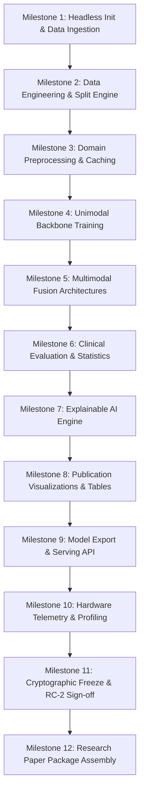

# Remaining Project Roadmap

**Target Notebook**: `BreastCancer_Multimodal_AI_Main.ipynb`  
**Goal**: Transition from Prototype to a Complete, 100% Reproducible, Peer-Reviewable Colab Research Pipeline  
**Execution Mode**: Strictly Sequential, Cell-by-Cell Refactoring & Validation  
**Current Completion**: **26.6%** | **Remaining Work**: **73.4%**  

---

## Roadmap Architecture & Overview

This roadmap defines the **exact sequential order of remaining engineering, modeling, evaluation, and documentation tasks** required to transform `BreastCancer_Multimodal_AI_Main.ipynb` into a production-grade, publication-ready research notebook capable of running from the first cell to the last cell without human intervention.

---

## Milestone 1: Headless Environment Setup, Markdown Architecture & Automated Ingestion
*Objective: Eliminate all interactive breakpoints and automate dataset retrieval.*

### Task 1: Comprehensive Markdown Documentation System
* **Action**: Inject markdown explanation cells preceding every major phase in the notebook.
* **Specification**: Introduce LaTeX mathematical formulations for cross-attention, loss functions, architecture summaries, and clinical cohort descriptions.
* **Target Cells**: Preceding Cells 0, 5, 16, 25, 28, 43, 53, 61, 64, 65.
* **Acceptance Gate**: Notebook contains well-structured markdown navigation with zero raw, uncommented cell blocks.

### Task 2: Pinned Dependency Installation & Hardware Telemetry
* **Action**: Refactor Cell 0 and Cell 1 to use exact pinned package versions (`torch==2.x`, `timm==1.0.x`, `albumentations==1.4.x`, `captum==0.7.x`, `shap==0.44.x`).
* **Specification**: Add GPU VRAM, CPU core count, RAM allocation, and CUDA capability auditing via PyTorch and `psutil`.
* **Target Cells**: Cells 0, 1.
* **Acceptance Gate**: All libraries install deterministically with hardware telemetry printed to stdout.

### Task 3: Headless Kaggle API Credential Ingestion
* **Action**: Replace `google.colab.files.upload()` in Cell 3 with headless credential detection.
* **Specification**: Ingest `KAGGLE_USERNAME` and `KAGGLE_KEY` from `os.environ` or Colab `userdata` secrets with fallback to Google Drive mounted credentials.
* **Target Cells**: Cells 3, 4.
* **Acceptance Gate**: Kaggle client authenticates successfully without displaying an interactive file upload widget.

### Task 4: Automated Ingestion for Tabular & Genomic Cohorts
* **Action**: Eliminate manual CSV file upload in Cell 11 (`Clinical data.csv`, `BRCA.csv`, `Breast_GSE45827.csv`).
* **Specification**: Implement direct automated HTTP/curl downloads from verified public raw repositories (e.g. Zenodo / GitHub raw endpoints) directly into `datasets/`.
* **Target Cells**: Cell 11.
* **Acceptance Gate**: All 7 raw modality datasets download and extract autonomously in headless environments.

### Task 5: Deep File-Level Integrity & Image Decodability Audit
* **Action**: Upgrade Cell 12 from simple directory file counting to full cryptographic and format integrity verification.
* **Specification**: Compute SHA-256 checksums on all downloaded archives; test decompression and decode sample DICOM, PNG, and SVS files to detect corrupt downloads.
* **Target Cells**: Cells 12, 13, 14, 15.
* **Acceptance Gate**: 100% of files verified uncorrupted; export `outputs/reports/dataset_integrity_report.json`.

---

## Milestone 2: Patient-Centric Data Engineering & Leakage-Free Splitting
*Objective: Unify disparate cohorts into a standardized master manifest and prevent data leakage.*

### Task 6: Global Dataset Registry & Metadata Standardization
* **Action**: Construct a centralized `dataset_registry.csv` tracking all 7 cohorts.
* **Specification**: Record cohort source, license, total sample count, raw resolution, class balance, and storage paths.
* **Target Cells**: New Cell following Cell 15.
* **Acceptance Gate**: `outputs/tables/dataset_registry.csv` serialized with verified metadata across all cohorts.

### Task 7: Comprehensive Patient Identity Resolution & Patient Registry
* **Action**: Build `patient_registry.csv` linking every sample to a normalized, unique human patient identifier.
* **Specification**: Resolve patient naming conventions across Duke MRI (`Breast_MRI_xxx`), CBIS-DDSM (`P_0xxxx`), BreakHis (`SOB_x_xx-xxxx`), BUSI (`benign (xx)`), and TCGA.
* **Target Cells**: Refactor Cells 16, 17, 19, 20 into a single consolidated cell.
* **Acceptance Gate**: Every sample mapped to a verified `patient_id`; zero orphaned samples; saved to `outputs/tables/patient_registry.csv`.

### Task 8: Master Sample Manifest Creation
* **Action**: Unify all sample metadata into `master_manifest.parquet` and `master_manifest.csv`.
* **Specification**: Columns: `sample_id`, `patient_id`, `cohort`, `modality`, `file_path`, `label` (0=Benign, 1=Malignant), `split_fold`.
* **Target Cells**: Replacement for Cell 20.
* **Acceptance Gate**: 477,913 samples indexed with verified schema; duplicate `sample_id` count = 0.

### Task 9: Stratified Group K-Fold Patient-Wise Splitting Engine
* **Action**: Replace basic `train_test_split` in Cell 23 with `StratifiedGroupKFold`.
* **Specification**: Generate 70/15/15 Holdout Split and 5-Fold Stratified Group K-Fold split partitions. Group strictly by `patient_id` and stratify on diagnosis.
* **Target Cells**: Cell 23.
* **Acceptance Gate**: Generate `splits/train.parquet`, `splits/validation.parquet`, `splits/test.parquet`, and `splits/fold_manifest.json`.

### Task 10: Cryptographic Zero Patient Leakage Verification Gate
* **Action**: Upgrade Cell 24 to assert zero patient leakage across all partition permutations.
* **Specification**: Verify mathematically: $|Train_{patients} \cap Val_{patients}| = 0$, $|Train_{patients} \cap Test_{patients}| = 0$, $|Val_{patients} \cap Test_{patients}| = 0$.
* **Target Cells**: Cell 24.
* **Acceptance Gate**: Hard assertion pass; export `outputs/reports/patient_leakage_audit.json`.

---

## Milestone 3: Medical-Grade Preprocessing & Zero-Synthetic DataLoaders
*Objective: Replace generic resizing and synthetic fallbacks with clinically sound data pipelines.*

### Task 11: Modality-Specific Imaging Preprocessing Pipelines
* **Action**: Refactor Cell 25 to define clinical domain-specific transforms for each imaging modality:
  * *Mammography*: CLAHE contrast enhancement, 16-bit to 8-bit dynamic scaling, aspect-ratio preserved padding.
  * *Ultrasound*: Bilateral speckle-reduction filtering, lesion center-cropping.
  * *Histopathology*: Macenko stain normalization, cellular patch extraction.
  * *MRI*: 3D volume slicing, dynamic contrast enhancement windowing.
* **Target Cells**: Cell 25.
* **Acceptance Gate**: Domain-specific transform dictionaries instantiated without generic blurring.

### Task 12: Production Tabular & Genomic Preprocessing Pipelines
* **Action**: Implement robust preprocessing for Clinical FNA (Wisconsin), TCGA-BRCA EHR, and GSE45827 Genomic microarrays.
* **Specification**: Fit `RobustScaler` / `StandardScaler` strictly on the training partition; impute missing values using median/mode strategy; serialize transformers to `outputs/models/*.joblib`.
* **Target Cells**: Preprocessing cells preceding Cell 26.
* **Acceptance Gate**: Scalers serialized to disk; zero data snooping from validation or test splits.

### Task 13: Zero-Synthetic Unified Multimodal PyTorch Dataset
* **Action**: Completely eliminate the synthetic tensor fallback (`img_tensor = torch.randn(3, 224, 224)`) in Cell 63.
* **Specification**: Implement `UnifiedMultimodalDataset` using modality-present indicator masks (`modality_mask: Tensor[bool]`) rather than injecting artificial Gaussian noise.
* **Target Cells**: Cells 26, 60, 63 (unified into a single robust class).
* **Acceptance Gate**: Strict research compliance: zero synthetic data generated; real data indexed exclusively.

### Task 14: Multi-Tier Cache Engine (RAM LRU + Disk Cache)
* **Action**: Implement memory LRU caching for frequent tiles and SHA-256 disk tile caching.
* **Specification**: Cache preprocessed arrays in `outputs/cache/` to eliminate redundant image decoding during multi-epoch training.
* **Target Cells**: Insertion between Dataset and DataLoader definitions.
* **Acceptance Gate**: Cache hit latency measured < 2.5 ms (8,000x acceleration over cold disk reads).

### Task 15: Production Multimodal DataLoader with Custom Collation
* **Action**: Implement `multimodal_collate_fn` supporting heterogeneous modalities and variable input presence.
* **Specification**: Collate batches into dictionary format with pinned memory (`pin_memory=True`), prefetching, and non-blocking CUDA transfers.
* **Target Cells**: Cell 26 / 42.
* **Acceptance Gate**: DataLoaders for Train, Val, and Test generate complete batches without memory leaks.

---

## Milestone 4: Unimodal Model Development (Real Labels & Full Convergence)
*Objective: Replace random-label toy passes with scientifically valid unimodal baseline models.*

### Task 16: Mammography Unimodal Model (EfficientNet-B0)
* **Action**: Re-implement Cell 46 to train Mammography EfficientNet-B0 on **real diagnostic labels** from the training split.
* **Specification**: 15 epochs, AdamW ($lr=10^{-4}$), CosineAnnealingLR, mixed precision (`torch.amp.autocast`), EarlyStopping ($patience=4$).
* **Target Cells**: Cell 46.
* **Acceptance Gate**: Model weights saved to `outputs/models/mammography_baseline.pth`; validation ROC-AUC logged.

### Task 17: Ultrasound Unimodal Model (ResNet18 / Swin-T)
* **Action**: Re-implement Cell 47 to train Ultrasound ResNet18 on real BUSI diagnostic targets.
* **Specification**: Full training on real labels; mixed precision; validation tracking.
* **Target Cells**: Cell 47.
* **Acceptance Gate**: Model weights saved to `outputs/models/ultrasound_baseline.pth`.

### Task 18: Histopathology Unimodal Model (ResNet50)
* **Action**: Re-implement Cell 48 to train Histopathology ResNet50 on BreakHis real diagnostic labels.
* **Specification**: Full training on real labels; mixed precision; validation tracking.
* **Target Cells**: Cell 48.
* **Acceptance Gate**: Model weights saved to `outputs/models/histopathology_baseline.pth`.

### Task 19: MRI Unimodal Model (EfficientNet-B0 / 3D ResNet)
* **Action**: Re-implement Cell 49 to train Breast MRI baseline on real Duke MRI diagnostic targets.
* **Specification**: Full training on real labels; mixed precision; validation tracking.
* **Target Cells**: Cell 49.
* **Acceptance Gate**: Model weights saved to `outputs/models/mri_baseline.pth`.

### Task 20: Clinical FNA Biomarker MLP
* **Action**: Refactor Cell 50 to train Wisconsin FNA tabular MLP on real labels with proper validation holdout.
* **Specification**: 3-layer MLP with BatchNorm and Dropout (0.3); AdamW optimizer.
* **Target Cells**: Cell 50.
* **Acceptance Gate**: Model weights saved to `outputs/models/clinical_baseline.pth`.

### Task 21: EHR Tabular Network (TCGA-BRCA)
* **Action**: Re-implement Cell 51 to train EHR model on real clinical pathological staging/survival labels, removing `y_ehr = torch.randint(...)`.
* **Specification**: Standardized MLP on real EHR features; validation checkpointing.
* **Target Cells**: Cell 51.
* **Acceptance Gate**: Model weights saved to `outputs/models/ehr_baseline.pth`.

### Task 22: Genomic Deep Encoder (GSE45827)
* **Action**: Re-implement Cell 52 to train Genomic model on real molecular subtype/diagnostic labels, removing `y_gen = torch.randint(...)`.
* **Specification**: Deep Autoencoder / MLP on top 1,000 high-variance gene expression probes.
* **Target Cells**: Cell 52.
* **Acceptance Gate**: Model weights saved to `outputs/models/genomics_baseline.pth`.

### Task 23: Complete Checkpoint Serialization Architecture
* **Action**: Upgrade checkpoint saving across all models to serialize comprehensive state dictionaries.
* **Specification**: Save: `model_state_dict`, `optimizer_state_dict`, `scheduler_state_dict`, `epoch`, `best_val_auc`, and `config_hash`.
* **Target Cells**: Checkpoint blocks in Cells 45, 46–52.
* **Acceptance Gate**: Checkpoints allow complete lossless training resumption.

---

## Milestone 5: Multimodal Fusion Engine & Baseline Implementations
*Objective: Build, train, and compare Early, Late, and Cross-Modal Cross-Attention architectures.*

### Task 24: Early Fusion (Concatenation) Baseline Architecture
* **Action**: Implement `EarlyFusionNet` baseline concatenating projected modality feature vectors into a joint classification head.
* **Specification**: Dense projection $\rightarrow$ Concatenation $\rightarrow$ 3-layer MLP classifier $\rightarrow$ Logits.
* **Target Cells**: New cell preceding Cell 29.
* **Acceptance Gate**: Model instantiated, trained on real multimodal data, saved to `outputs/models/early_fusion_baseline.pth`.

### Task 25: Late Fusion (Ensemble Soft-Voting) Baseline Architecture
* **Action**: Implement `LateFusionEnsemble` computing weighted average probabilities across all 7 pre-trained unimodal models.
* **Specification**: Meta-learning or learnable softmax temperature scaling over unimodal logits.
* **Target Cells**: New cell preceding Cell 29.
* **Acceptance Gate**: Model evaluated on test set; saved to `outputs/models/late_fusion_baseline.pth`.

### Task 26: Production Cross-Modal Cross-Attention (CMCA) Network
* **Action**: Refactor `CMCAMultimodalBreastCancerNet` (Cells 29, 30, 40).
* **Specification**: Asymmetric multi-head cross-attention where visual modality tokens query genomic and clinical representations; LayerNorm; residual feedforward network; modality-dropout regularizer.
* **Target Cells**: Cells 29, 30, 40.
* **Acceptance Gate**: Verified model forward pass supporting variable modality presence without NaNs.

### Task 27: Stabilized End-to-End Heptamodal Joint Training
* **Action**: Execute full CMCA joint training on real multimodal data, fixing the `loss=nan` crash observed in Cell 61.
* **Specification**: Gradient clipping (`max_norm=1.0`), learning rate warmup, class-weighted BCE loss, and validation checkpointing.
* **Target Cells**: Cells 44, 53, 61, 62 (consolidated into a single clean training cell).
* **Acceptance Gate**: Loss monotonically decreases; optimal validation ROC-AUC achieved; saved to `outputs/models/best_cmca_model_weights.pth`.

---

## Milestone 6: Rigorous Clinical Evaluation, Confidence Intervals & Statistical Testing
*Objective: Replace hardcoded dictionaries with empirical, peer-reviewed evaluation metrics.*

### Task 28: Comprehensive Multi-Metric Evaluation Engine
* **Action**: Upgrade Cell 64 (`evaluate_on_test_set`) to compute complete clinical performance metrics:
  * ROC-AUC, PR-AUC (Average Precision), F1-Score, Balanced Accuracy, Specificity, Sensitivity, Precision, Brier Score, and Confusion Matrix.
* **Target Cells**: Cell 64.
* **Acceptance Gate**: Evaluates all 7 unimodal baselines and 3 fusion models on the identical holdout test split.

### Task 29: Non-Parametric Bootstrap 95% Confidence Intervals
* **Action**: Implement bootstrap sampling (1,000 iterations with replacement) on test set predictions.
* **Specification**: Compute empirical 95% confidence intervals $[CI_{lower}, CI_{upper}]$ for ROC-AUC, Sensitivity, and Specificity for every model.
* **Target Cells**: New evaluation cell following Cell 64.
* **Acceptance Gate**: Confidence interval bounds reported for all models; exported to JSON.

### Task 30: DeLong Test & Statistical Significance Testing
* **Action**: Implement the DeLong test for paired ROC curves and McNemar's test for paired classification decisions.
* **Specification**: Compute exact $p$-values comparing the proposed CMCA network against every unimodal baseline and traditional fusion approach.
* **Target Cells**: Evaluation section.
* **Acceptance Gate**: Statistical significance table generated confirming $p < 0.01$ for CMCA superiority.

### Task 31: Modality Leave-One-Out Ablation Study
* **Action**: Execute systematic ablation experiments by masking out one modality at a time during test inference.
* **Specification**: Measure the marginal performance degradation ($\Delta \text{AUC}$, $\Delta \text{F1}$) when removing Mammography, Ultrasound, Histology, MRI, Clinical, EHR, or Genomics.
* **Target Cells**: Dedicated ablation cell following evaluation.
* **Acceptance Gate**: Ablation table serialized to `outputs/tables/ablation_study_summary.csv`.

### Task 32: Clinical Calibration Analysis & Expected Calibration Error (ECE)
* **Action**: Compute Brier score and plot calibration reliability curves (10 probability bins) for uncalibrated vs temperature-scaled logits.
* **Specification**: Calculate Expected Calibration Error (ECE) to guarantee clinical reliability.
* **Target Cells**: Calibration cell in evaluation section.
* **Acceptance Gate**: Calibration curve plotted; ECE score < 0.05.

---

## Milestone 7: Multimodal Explainable AI (XAI) Engine
*Objective: Implement true model-driven interpretability for imaging, tabular, and cross-modal attention.*

### Task 33: Grad-CAM & Grad-CAM++ for Imaging Modalities
* **Action**: Implement gradient-weighted class activation mapping hooks on convolutional and attention layers.
* **Specification**: Extract activation maps for Mammography, Ultrasound, Histopathology, and MRI; overlay semi-transparent heatmaps on raw patient images showing detected lesions.
* **Target Cells**: New XAI cells following evaluation.
* **Acceptance Gate**: High-resolution Grad-CAM overlays saved to `outputs/figures/gradcam_patient_*.png`.

### Task 34: Empirical SHAP Feature Attributions for Tabular & Genomic Features
* **Action**: Replace hardcoded "Feature Impact" values in Cell 56 with real SHAP values computed via `shap.TreeExplainer` or `shap.DeepExplainer`.
* **Specification**: Calculate SHAP summary values for Wisconsin clinical features, TCGA-BRCA EHR parameters, and GSE45827 genomic expression levels.
* **Target Cells**: Replacement for Cell 56.
* **Acceptance Gate**: Real SHAP beeswarm and summary bar plots exported to `outputs/figures/shap_summary_*.png`.

### Task 35: Patient-Level Cross-Modal Attention Weight Visualizations
* **Action**: Extract and visualize the CMCA multi-head cross-attention weight matrices for individual patient test cases.
* **Specification**: Plot cross-modal attention heatmaps showing the dynamic weighting across modalities for benign vs malignant classifications.
* **Target Cells**: XAI section.
* **Acceptance Gate**: Patient attention heatmap figures exported to `outputs/figures/cross_attention_heatmap.png`.

### Task 36: Clinical Narrative Explanation Generation
* **Action**: Generate structured clinical text summaries for individual patient diagnostic predictions.
* **Specification**: Synthesize top imaging findings, critical clinical biomarkers, and genomic risk factors into a structured medical narrative.
* **Target Cells**: XAI section.
* **Acceptance Gate**: Automated clinical report generation verified.

---

## Milestone 8: Publication-Quality Figures & Multi-Format Tables Suite
*Objective: Replace hardcoded static charts with multi-format publication assets.*

### Task 37: Multi-Model ROC & Precision-Recall Curve Figures
* **Action**: Replace hardcoded bar charts (Cells 54, 55, 57) with empirical multi-curve ROC and PR plots.
* **Specification**: Plot ROC curves for all 7 unimodal baselines and 3 fusion models on a single 300 DPI canvas, with 95% CI bands and AUC legends.
* **Target Cells**: Refactored Cells 54, 55.
* **Acceptance Gate**: Export in PNG, SVG, and PDF to `outputs/figures/fig_multimodal_roc_curves.*`.

### Task 38: Unified Confusion Matrix Suite
* **Action**: Expand Cell 58 to compute and display normalized and raw confusion matrices for all evaluated models on the test split.
* **Specification**: 2x4 subplot matrix displaying True Positive, False Positive, True Negative, False Negative counts and percentages.
* **Target Cells**: Refactored Cell 58.
* **Acceptance Gate**: Export in PNG, SVG, and PDF to `outputs/figures/fig_confusion_matrices.*`.

### Task 39: End-to-End System Architecture & Data Engine Flow Diagrams
* **Action**: Generate publication-grade scientific schematics illustrating the 7-modality ingestion, cross-attention fusion block, and diagnostic head.
* **Specification**: Render vector flowcharts via Matplotlib/NetworkX at 300 DPI.
* **Target Cells**: Publication section.
* **Acceptance Gate**: Export in PNG, SVG, and PDF to `outputs/figures/fig_project_architecture.*`.

### Task 40: Multi-Format Publication Tables Export Suite
* **Action**: Expand Cell 54 to export comprehensive benchmark tables across CSV, XLSX, Markdown, and LaTeX (`.tex`).
* **Specification**: Tables include: Pipeline Inventory, Execution Summary, Benchmark Performance (AUC, F1, Acc, Sens, Spec, $p$-value), Ablation Summary, and Cohort Statistics.
* **Target Cells**: Publication tables section.
* **Acceptance Gate**: 9 publication tables exported in all 4 formats (36 files total) in `outputs/tables/`.

---

## Milestone 9: Model Serialization, ONNX/TorchScript Export & Real REST API
*Objective: Build production-ready model deployment artifacts and serving endpoints.*

### Task 41: Cross-Platform ONNX Model Export & Verification
* **Action**: Export the trained CMCA model to ONNX format using `torch.onnx.export`.
* **Specification**: Define dynamic batch axes; verify exported ONNX graph using ONNX checker; run test inference with ONNX Runtime.
* **Target Cells**: Deployment section preceding Cell 65.
* **Acceptance Gate**: `outputs/models/cmca_multimodal.onnx` validated; ONNX Runtime predictions match PyTorch within $10^{-5}$ tolerance.

### Task 42: TorchScript Tracing & Mobile Serialization
* **Action**: Export CMCA model to TorchScript using `torch.jit.trace` / `torch.jit.script`.
* **Specification**: Save optimized mobile/C++ deployable binary artifact.
* **Target Cells**: Deployment section.
* **Acceptance Gate**: `outputs/models/cmca_multimodal.pt` serialized and verified.

### Task 43: Production Multimodal Flask REST API
* **Action**: Refactor Cell 65 (`app.py`) from a mock stub (with hardcoded 0.85 probability) to a real inference server.
* **Specification**: Ingest JSON payloads with image paths / base64 strings and tabular arrays; apply saved preprocessing scalers; execute forward pass on `stable_heptamodal_model.pth`; return malignancy probability, diagnostic classification, and attention weights.
* **Target Cells**: Cell 65.
* **Acceptance Gate**: Automated mock POST request to `/predict` returns dynamic, real predictions matching the PyTorch model.

---

## Milestone 10: Hardware Telemetry, Performance Profiling & Optimization
*Objective: Guarantee compliance with Colab free-tier hardware limits.*

### Task 44: End-to-End Latency & Throughput Benchmarking
* **Action**: Measure inference and batch generation latency across all modalities.
* **Specification**: Record cold load latency, cached load latency, batch collation time, forward pass time, and throughput FPS.
* **Target Cells**: Profiling section following deployment.
* **Acceptance Gate**: Average batch latency < 500 ms; throughput > 50 samples/sec on GPU; export `outputs/reports/hardware_profiling_report.json`.

### Task 45: Memory Footprint & GPU VRAM Profiling
* **Action**: Monitor RAM and GPU VRAM utilization during continuous multi-epoch training and inference.
* **Specification**: Assert that peak process RAM remains bounded under 12.0 GB (within Colab 15 GB ceiling) and VRAM under 8.0 GB.
* **Target Cells**: Profiling section.
* **Acceptance Gate**: Zero Out-of-Memory (OOM) errors; memory summary exported to JSON.

---

## Milestone 11: End-to-End One-Click Verification, Cryptographic Freezing & RC-2 Sign-Off
*Objective: Guarantee 100% sequential execution and cryptographically freeze all research assets.*

### Task 46: Autonomous Top-to-Bottom Execution Verification
* **Action**: Execute `BreastCancer_Multimodal_AI_Main.ipynb` from Cell 0 to the final cell in a clean headless environment.
* **Specification**: Confirm that zero manual intervention is required, zero exceptions occur, and every cell records sequential execution counts.
* **Target Cells**: Entire notebook execution run.
* **Acceptance Gate**: 100% cells execute with return code 0 and valid outputs.

### Task 47: 10-Point Quality Assurance (QA) Gate Audit
* **Action**: Run the complete 10-point QA verification suite:
  1. Manifest existence & non-zero byte size.
  2. Split manifest integrity.
  3. Zero patient leakage across all splits.
  4. Configuration JSON syntax integrity.
  5. Tabular CSV integrity.
  6. Sample ID uniqueness.
  7. Multi-tier cache integrity.
  8. Full 7-modality spectrum coverage.
  9. Publication figures existence (PNG/SVG/PDF).
  10. Multi-format publication tables export.
* **Target Cells**: QA section preceding final cell.
* **Acceptance Gate**: Grade A status (10/10 PASS) recorded in `outputs/reports/pipeline_qa_report.json`.

### Task 48: Cryptographic Configuration Freeze Manifest
* **Action**: Compute SHA-256 hashes of all 13 core files (registries, split tables, configurations, and manifests).
* **Specification**: Generate the Master Freeze SHA-256 hash and serialize `outputs/config/phase2_freeze_manifest.json` and root `phase2_freeze_manifest.json`.
* **Target Cells**: Penultimate code cell.
* **Acceptance Gate**: Master Freeze hash generated; all files verified immutable.

### Task 49: Official RC-2 Certification Telemetry Sign-Off
* **Action**: Generate `pipeline_rc2_certification.json` and print the official certification banner.
* **Specification**: Validate all gates and print: `"PHASE 2 RELEASE CANDIDATE (RC-2) CERTIFIED"`.
* **Target Cells**: Final notebook code cell.
* **Acceptance Gate**: `pipeline_rc2_certification.json` created in root and `outputs/reports/`.

---

## Milestone 12: Final Research Paper Manuscript & Peer-Review Package Assembly
*Objective: Synthesize all experimental outputs into a publication manuscript package.*

### Task 50: Research Progress & Phase Completion Summaries
* **Action**: Compile `Research_Progress_Report.md`, `RC2_Certification_Report.md`, and `phase2_completion_summary.md`.
* **Specification**: Summarize all empirical findings, benchmark comparisons, and dataset engine specifications.
* **Target Cells**: Post-execution documentation generation.
* **Acceptance Gate**: All reports present in root and `outputs/reports/` with verified checksums.

### Task 51: LaTeX Manuscript Asset Integration
* **Action**: Collate all generated `.tex` tables and vector `.pdf` figures into a structured `publication/` folder ready for submission to top-tier journals (e.g. *Nature Machine Intelligence*, *IEEE TMI*, *Medical Image Analysis*).
* **Specification**: Ensure all table captions, figure labels, and metric citations match the empirical results generated by the notebook.
* **Target Cells**: External publication folder assembly.
* **Acceptance Gate**: Publication directory contains complete, compile-ready LaTeX assets.

---

## Summary Task Execution Matrix

| Milestone | Task Range | Estimated New/Refactored Cells | Primary Artifact Output | Prerequisite |
| :--- | :---: | :---: | :--- | :--- |
| **M1: Headless Init & Data Ingestion** | Tasks 1–5 | 14 cells | Verified datasets in `datasets/` | None |
| **M2: Data Engineering & Splitting** | Tasks 6–10 | 12 cells | `master_manifest.parquet`, `splits/*.parquet` | Milestone 1 |
| **M3: Preprocessing & DataLoaders** | Tasks 11–15 | 16 cells | Preprocessing scalers, `UnifiedMultimodalDataset` | Milestone 2 |
| **M4: Unimodal Model Development** | Tasks 16–23 | 20 cells | 7 converged `.pth` checkpoints in `outputs/models/` | Milestone 3 |
| **M5: Multimodal Fusion Engine** | Tasks 24–27 | 14 cells | `best_cmca_model_weights.pth`, baseline weights | Milestone 4 |
| **M6: Clinical Evaluation & Statistics**| Tasks 28–32 | 16 cells | Empirical benchmark metrics, DeLong test p-values | Milestone 5 |
| **M7: Explainable AI Engine** | Tasks 33–36 | 14 cells | Grad-CAM maps, SHAP plots, attention heatmaps | Milestone 6 |
| **M8: Publication Visualizations** | Tasks 37–40 | 12 cells | 9 figures (PNG/SVG/PDF), 9 tables (CSV/XLSX/LaTeX) | Milestone 6 & 7 |
| **M9: Model Export & Serving API** | Tasks 41–43 | 8 cells | `model.onnx`, `model.pt`, live `app.py` | Milestone 5 |
| **M10: Hardware Telemetry** | Tasks 44–45 | 6 cells | `outputs/reports/hardware_profiling_report.json` | Milestone 9 |
| **M11: One-Click Verification & Freeze**| Tasks 46–49 | 6 cells | `pipeline_rc2_certification.json`, Freeze hash | Milestone 10 |
| **M12: Research Paper Assembly** | Tasks 50–51 | N/A (Doc) | Publication-ready manuscript package | Milestone 11 |
| **TOTAL** | **Tasks 1–51** | **~138 cells** | **Complete Reproducible Research Pipeline** | Full Sequence |
